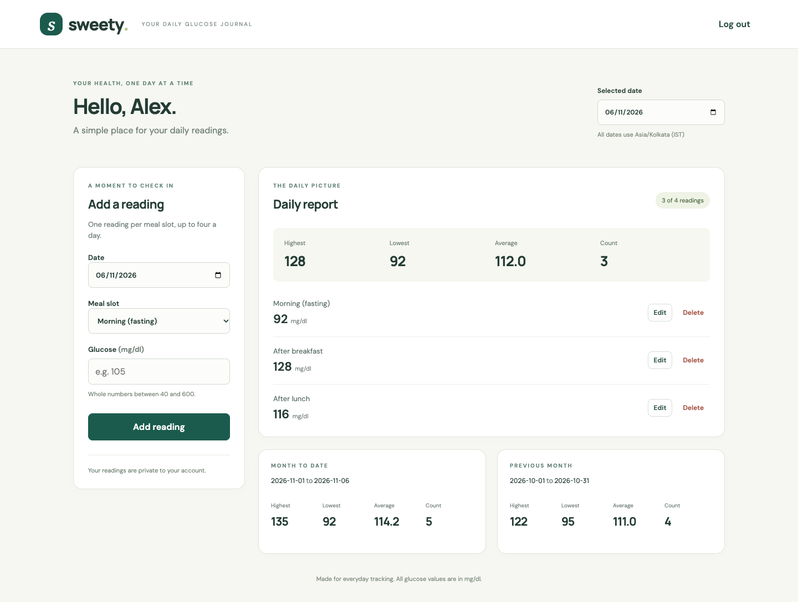
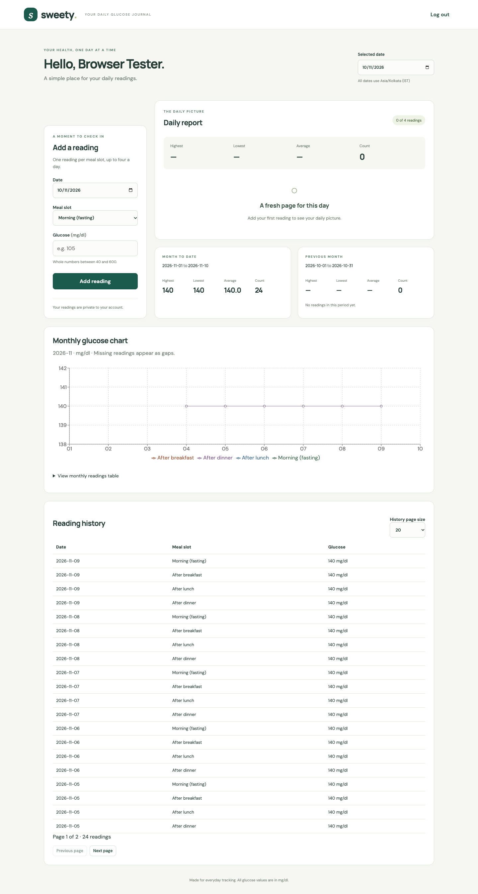
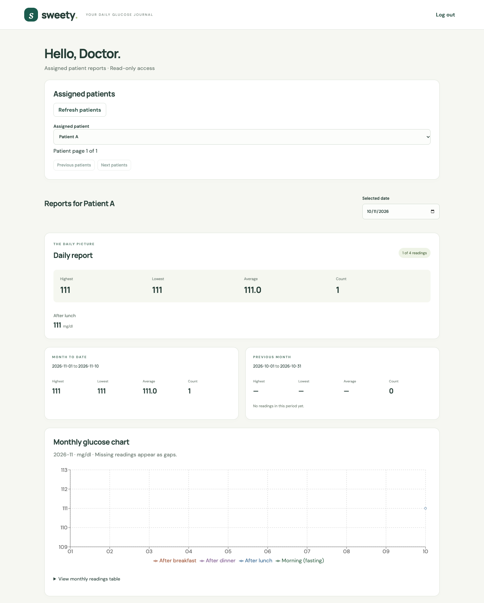
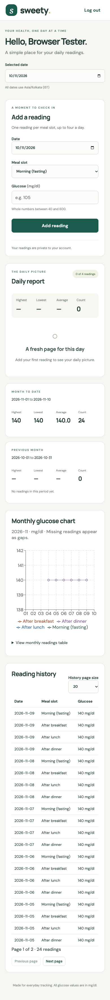
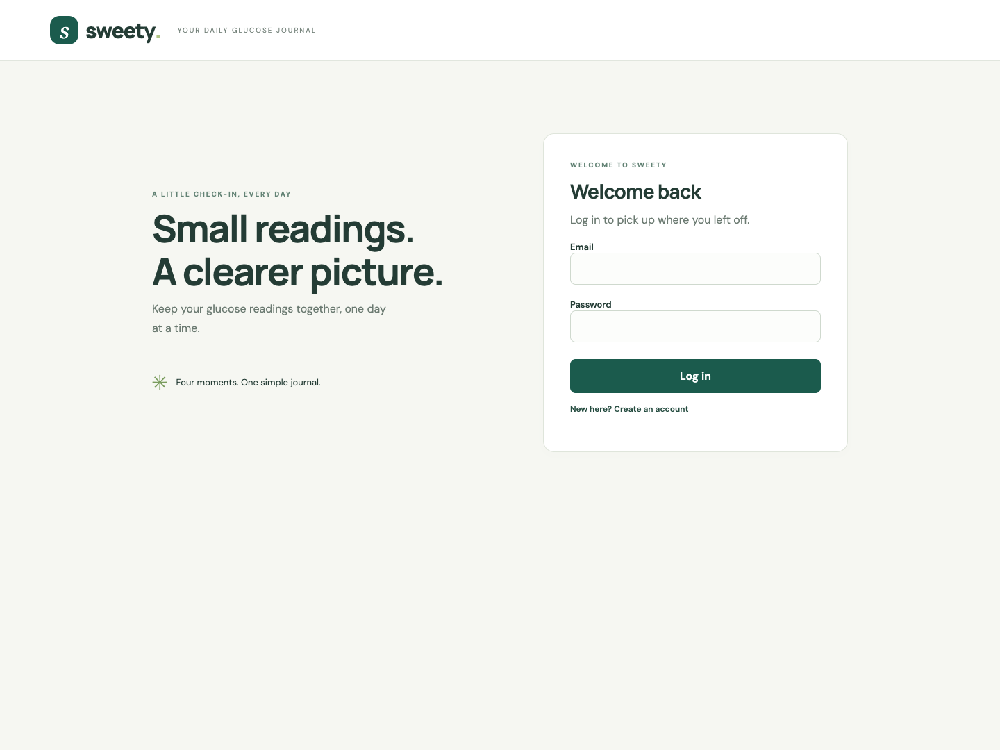
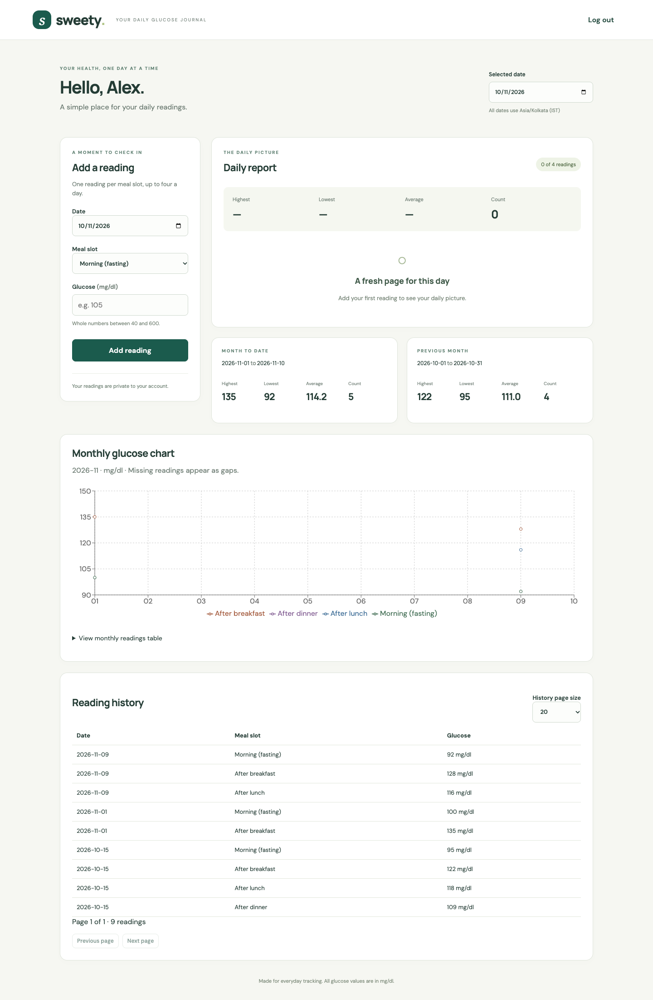

# Sweety – Blood Glucose Tracker

A private blood glucose journal built with React, Express and PostgreSQL. Patients log readings across four daily meal slots, view reports and monthly trend charts. Doctors get read-only access to assigned patients.



**Live**: [sweety-blood-glucose-tracker-tan.vercel.app](https://sweety-blood-glucose-tracker-tan.vercel.app)

All six selected bonus features are implemented. The web/API and report cache
are verified on production HTTPS; see the [final audit](docs/optional-features/verification.md)
and [implementation plan](docs/optional-features/plan.md). Docker is excluded.
The separate reminder worker is verified locally with real Upstash; no always-on
worker host is running.

## Tech Stack

React 19 · Express 5 · PostgreSQL · Vite · Recharts · Upstash Redis (optional cache) · BullMQ (background jobs) · Playwright · Vitest

## Setup

Requires Node.js 22.22.2+, 24.15+, or 26+ on those supported release lines,
and PostgreSQL.

```sh
npm ci
createdb sweety
createdb sweety_test
cp .env.example .env
# Edit .env — set DATABASE_URL, TEST_DATABASE_URL, and SESSION_SECRET (32+ chars)
npm run db:migrate
npm run db:seed
npm run dev
```

Open http://127.0.0.1:5173. API runs on port 3001.

### Demo Accounts

| Email                 | Password           | Role                 |
| --------------------- | ------------------ | -------------------- |
| `demo@example.test`   | `Sweety-demo-2026` | Patient              |
| `other@example.test`  | `Sweety-demo-2026` | Patient              |
| `doctor@example.test` | `Sweety-demo-2026` | Doctor (views demo@) |

## Project Structure

```
client/              React SPA
  components/        ReadingForm, ReadingHistory, ReportPanels, MonthlyChart, DoctorDashboard
server/              Express API
  app.js             Routes, auth, validation, error handling
  reports.js         Report queries and cache-aware reader
  doctor.js          Doctor role routes
  jobs.js            BullMQ queue and worker setup
  worker.js          Standalone reminder worker process
  cache.js           Upstash Redis adapter
  dates.js           Timezone helpers (Asia/Kolkata)
db/                  SQL migrations (001–004)
lib/redis.ts         Typed client entry point
lib/redis.js         Shared Redis runtime implementation
scripts/             migrate, seed, manage-access, test runners
api/index.js         Vercel serverless entrypoint
tests/               API, browser, UI, cache, jobs, deployment tests
```

## API

### Auth

| Method | Endpoint             | Description                     |
| ------ | -------------------- | ------------------------------- |
| POST   | `/api/auth/register` | `{name, email, password}` → 201 |
| POST   | `/api/auth/login`    | `{email, password}` → session   |
| GET    | `/api/auth/me`       | Current user + server today     |
| POST   | `/api/auth/logout`   | Destroy session → 204           |

### Readings (patient)

| Method | Endpoint                        | Description                    |
| ------ | ------------------------------- | ------------------------------ |
| GET    | `/api/readings?date=YYYY-MM-DD` | Day's readings in slot order   |
| GET    | `/api/readings?page=1&limit=20` | Paginated history (20/50/100)  |
| POST   | `/api/readings`                 | `{date, slot, value}` → 201    |
| PUT    | `/api/readings/:id`             | `{date, slot, value, version}` |
| DELETE | `/api/readings/:id`             | `{version}` → 204              |

### Reports (patient)

| Method | Endpoint                             | Description                            |
| ------ | ------------------------------------ | -------------------------------------- |
| GET    | `/api/reports?date=YYYY-MM-DD`       | Daily + MTD + previous month summaries |
| GET    | `/api/reports/monthly?month=YYYY-MM` | Monthly readings for chart             |

### Doctor

| Method | Endpoint                                   | Description                   |
| ------ | ------------------------------------------ | ----------------------------- |
| GET    | `/api/doctor/patients`                     | Assigned patients (paginated) |
| GET    | `/api/doctor/patients/:id/reports`         | Patient's report summaries    |
| GET    | `/api/doctor/patients/:id/reports/monthly` | Patient's monthly chart data  |

Errors return `{error: {code, message, fields?}}`. Codes: `VALIDATION` (400), `AUTH_REQUIRED` (401), `ORIGIN_REJECTED` (403), `NOT_FOUND` (404), `DUPLICATE_SLOT` / `STALE_VERSION` (409), `RATE_LIMIT` (429).

## Key Design Choices

- **Dates use Asia/Kolkata** — future-date checks, midnight cutoffs, all server-side.
- **Optimistic concurrency** — readings carry a `version`; edits/deletes must match or get 409.
- **Reports in one query** — daily, MTD, and previous month computed in a single SQL CTE.
- **Cache invalidation** — `report_revision` increments in the same transaction as reading writes. Cache keys embed the revision, so stale keys are never read.
- **Slots enforced by DB** — `UNIQUE(user_id, reading_date, slot)` resolves races; 4 slots = max 4 readings/day.
- **Passwords** — bcrypt cost 12, max 72 UTF-8 bytes, constant-time comparison for unknown emails.

## Testing

```sh
npm run test:isolated       # Spins up temp PostgreSQL, runs API + browser tests
npm run test:ui             # Vitest + React Testing Library (13 component tests)
npm run test:jobs:integration  # Temp Redis + PostgreSQL, tests BullMQ scheduling/retries
npm run format:check        # Prettier
```

`test:isolated` needs `initdb`, `pg_ctl`, `createdb` on PATH (or set `POSTGRES_BIN`). No Docker needed.

Optional live checks:

```sh
npm run test:cache:live     # Real Upstash (needs TEST_UPSTASH_* in .env)
npm run test:deployment -- https://your-url.vercel.app
npm run test:deployed:browser -- https://your-url.vercel.app
```

Deployed browser checks are read-only by default. Supplying the explicit
`DEPLOYMENT_TEST_DATABASE_URL` enables synthetic registration/reading CRUD and
targeted cleanup. For the real deployed cache check, put that matching database
URL plus the deployment's Upstash REST URL/token and `CACHE_NAMESPACE` in an
ignored `.env.deployment-test.local`, then run:

```sh
node --env-file=.env.deployment-test.local tests/deployed-cache.js https://sweety-blood-glucose-tracker-tan.vercel.app
```

This verifies actual summary/chart cache entries, hit/TTL behavior and
create/edit/delete invalidation. It removes only its own account, sessions and
exact cache keys. Ordinary API tests truncate the separate `_test` database;
never use the production database as `TEST_DATABASE_URL`.

## Upstash Cache

The project database is **SweetyRedis**, Free plan, Singapore (`ap-southeast-1`),
with TLS enabled and eviction disabled. Private credentials are in ignored local
environment files and Vercel Secrets. Set `UPSTASH_REDIS_REST_URL`,
`UPSTASH_REDIS_REST_TOKEN` and a distinct `CACHE_NAMESPACE` per app database/environment.
Leaving both credentials blank disables caching. Reports use a 60-second TTL,
transactional revisions and PostgreSQL fallback during cache failures.

The requested `lib/redis.ts` entry point wraps the shared JavaScript client used
by the API, keeping Vercel runtime imports valid. The SDK handles object
serialization; requests have a one-second timeout and no retries. Keep these
credentials server-side, without a `VITE_` prefix.

## Doctor Access CLI

```sh
npm run access -- role --email user@example.test --role doctor
npm run access -- assign --doctor doc@example.test --patient pat@example.test
npm run access -- unassign --doctor doc@example.test --patient pat@example.test
```

## Reminder Worker

Optional BullMQ worker that logs patients with < 4 readings on completed days.

```sh
# .env: REDIS_URL=redis://127.0.0.1:6379, QUEUE_PREFIX=sweety:dev:jobs
npm run worker
npm run reminders:enqueue -- --date=2026-11-09  # Manual backfill
```

Runs daily at 00:05 IST. Idempotent — safe to retry.

For Upstash use its TCP/TLS `rediss://` URL, separate from the REST credentials,
and a unique queue prefix. The worker must remain running for continuous
reminders; Vercel API invocations do not host it. No paid worker host is selected.

## Deploy (Vercel + Neon)

Set in Vercel environment:

| Variable                   | Value                                      |
| -------------------------- | ------------------------------------------ |
| `DATABASE_URL`             | Neon pooled connection URL                 |
| `SESSION_SECRET`           | Random 32+ char string                     |
| `APP_ORIGIN`               | `https://your-app.vercel.app`              |
| `NODE_ENV`                 | `production`                               |
| `UPSTASH_REDIS_REST_URL`   | Upstash HTTPS endpoint, stored as a Secret |
| `UPSTASH_REDIS_REST_TOKEN` | Upstash token, stored as a Secret          |
| `CACHE_NAMESPACE`          | Unique production report-cache namespace   |

Run migrations manually against direct (unpooled) Neon URL:

```sh
node --env-file=.env.production.local scripts/migrate.js
node --env-file=.env.production.local scripts/seed.js
```

## Screenshots

|                                              |                                                             |
| -------------------------------------------- | ----------------------------------------------------------- |
|  |  |
|   |                       |
|          |         |
